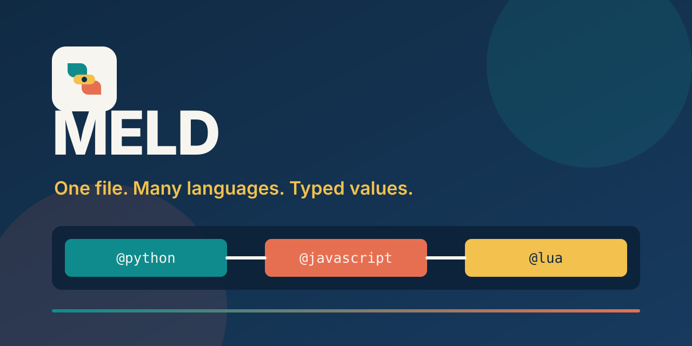

# Meld

<p align="center">
  
</p>

> One file. Many languages. Typed values.



[](https://github.com/enis1enis2/meld/actions/workflows/ci.yml)
[](https://github.com/enis1enis2/meld/actions/workflows/docs.yml)
[](https://github.com/enis1enis2/meld/actions/workflows/msrv.yml)
[](https://github.com/enis1enis2/meld/actions/workflows/audit.yml)
[](https://github.com/enis1enis2/meld/actions/workflows/fuzz.yml)

Meld is a language/toolchain where one `.meld` file can switch language
mid-file and pass typed values between regions. Coverage is open-ended: adding
a language costs a Lang Pack (manifest, grammar, runner), not a core change.

**Docs:** [SemVer](SEMVER.md) · [SBOM](SBOM.md) · [Security policy](SECURITY.md) ·
[Lang Pack spec](spec/lang-pack.md) · [Lang Library spec](spec/libraries.md) ·
[book](docs/src/SUMMARY.md) · [schema stability](docs/schema-stability.md) ·
[release artifacts](docs/release-artifacts.md)

## Install

The system package name is `meld-lang`; it provides three binaries: `meld`,
`meld-lsp` and `meld-pack`. No signed release has been published yet, so build
from source for now:

```sh
cargo build --workspace
```

The source build places the binaries under `./target/debug/`. Commands below
use that path; substitute `meld`, `meld-lsp` or `meld-pack` from `PATH` when a
packaged installation is available.

## Quick start

```sh
./target/debug/meld check examples/09-smoke.meld
./target/debug/meld run examples/09-smoke.meld
```

The smoke example prints:

```text
inline sum: 5
raw: ok
fence: ok
js: 20,40,60
lua: 3 values
```

Run the third-party pack example with:

```sh
MELD_PACKS=tests/fixtures/pack-third-party \
  ./target/debug/meld run examples/08-shell-pack.meld
```

The language-expansion example parses 15 additional languages and executes the
Bash region:

```sh
./target/debug/meld check examples/10-more-languages.meld
./target/debug/meld run examples/10-more-languages.meld
# prints: bash-ok
```

Every Lang Pack is also an installable Lang Library. Browse and install packs
from GitHub with the terminal installer:

```sh
cargo build -p meld-installer
./target/debug/meld-pack remote-list
./target/debug/meld-pack install bash typescript
./target/debug/meld-pack list
./target/debug/meld lib
```

`install` verifies the pack data against public Ed25519 trust roots and writes
the exact version to `meld.lock`; `remove`, `import`, `unimport`, `verify`,
`self-install` and `self-uninstall` are also available. Remote installs read
`packs/registry/trust-roots.toml` and `revocations.json` from the fetched tree
by default, so an unsigned or unknown-key pack is rejected. See
[spec/libraries.md](spec/libraries.md) for the full workflow.

## Syntax at a glance

```meld
#meld python

@python as producer {
    values = [1, 2, 3]
    export values as nums
}

@javascript as consumer {
    import nums from producer
    globalThis.doubled = nums.map(x => x * 2);
    console.log(globalThis.doubled.join(","));
}

print(⟦python: 2 + 3⟧)
```

See [spec/syntax.md](spec/syntax.md) for block, inline, fence, and raw-delimiter
forms, and [examples/README.md](examples/README.md) for runnable examples.

## Layout

- `spec/` — normative specs (syntax, value model, Lang Pack, T2 protocol, T3,
  LSP/tooling, registry, Lang Libraries).
- `crates/` — Rust core, grammars, T2/T3 backends, CLI, LSP server, Lang Library
  format (`meld-lib`) and terminal installer (`meld-installer`).
- `packs/` — 28 Lang Packs / Lang Libraries plus `packs/registry/` metadata
  (index, public trust roots, revocations, mirrors and a signed attestation).
  `python`, `javascript`, `lua` are L2 execution packs; `bash` is L1; the other
  24 are strict L0 syntax packs.
- `tools/` — grammar sync, pack tooling, reference harnesses.
- `tests/` — fixtures and conformance data.
- `research/composition/` — Phase 6 go/no-go study.
- `status/` — phase-by-phase completion notes.

## Languages

Bundled packs: `bash`, `c`, `cpp`, `csharp`, `css`, `dart`, `go`, `haskell`,
`html`, `java`, `javascript`, `json`, `lua`, `markdown`, `ocaml`, `php`,
`python`, `r`, `ruby`, `rust`, `scala`, `solidity`, `sql`, `toml`, `tsx`,
`typescript`, `yaml`, `zig`.

All 15 packs added in the 2026-11-20 expansion (`typescript`, `tsx`, `bash`,
`ruby`, `php`, `yaml`, `toml`, `csharp`, `haskell`, `ocaml`, `scala`, `zig`,
`r`, `dart`, `solidity`) are strict, pinned, signed, and generated through
`tools/gen_pack.py --strict`; `bash` additionally ships a T2 L1 worker. All 28
packs have a `library.toml`, so any of them can be installed with `meld-pack`.
See [status/language-expansion.md](status/language-expansion.md) for versions and
judgment calls, and [status/language-libraries.md](status/language-libraries.md)
for installer evidence.

## Verification

Install the Python test dependency first. CI requests a floating Python `3.12`
patch because an exact patch such as `3.12.9` can be absent from runner images;
`requirements-ci.txt` pins the only Python dependency, `cryptography==50.0.2`.

```sh
python -m pip install -r requirements-ci.txt
cargo test --workspace
python3 -m unittest discover -s tools/tests -v
python3 tools/fuzz_splitter.py
python3 tools/meld_check_ref.py
python3 tools/highlight_ref.py
python3 tools/t2_ref.py
python3 tools/sync_grammars.py --check
./target/debug/meld-pack verify packs/bash
./target/debug/meld-pack verify packs/bash \
  --trust-roots packs/registry/trust-roots.toml \
  --revocations packs/registry/revocations.json
python3 tools/packtool.py verify-registry packs/registry \
  --trust-roots packs/registry/trust-roots.toml \
  --revocations packs/registry/revocations.json --verify-packs
python3 tools/packtool.py verify packs/bash \
  --trust-roots packs/registry/trust-roots.toml \
  --revocations packs/registry/revocations.json
./target/debug/meld-pack list
```

`meld-pack verify` without trust roots checks checksums and signature shape;
strict packs always require `signature.ed25519`, and passing the public trust
roots proves the Ed25519 signature. The private key is kept outside the repo
and is never used for verification. Set `MELD_LIB_ROOT` to isolate installed
libraries in tests.

Toolchains: Rust (with `wasm32-unknown-unknown` for regenerating the T3
component and a C compiler for building the expanded grammar set), Python
3.11+, Node.js, Lua, and `sh` for the built-in Bash pack. `meld doctor` reports
what is present; it never installs anything.

See [status/production-readiness.md](status/production-readiness.md) for the
final evidence snapshot, and [status/phase-1.md](status/phase-1.md) through
[status/phase-7.md](status/phase-7.md),
[status/language-expansion.md](status/language-expansion.md), and
[status/language-libraries.md](status/language-libraries.md) for implementation
details and judgment calls.
